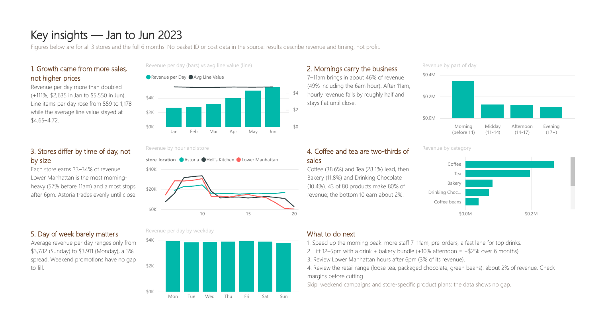
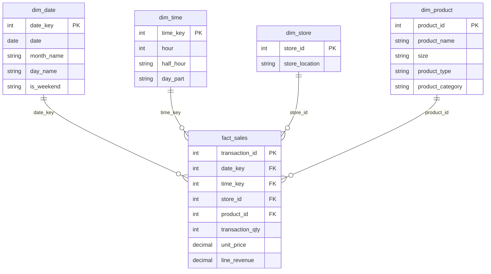
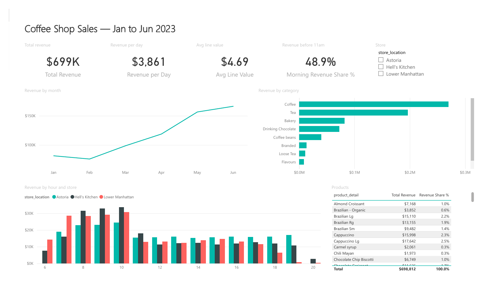
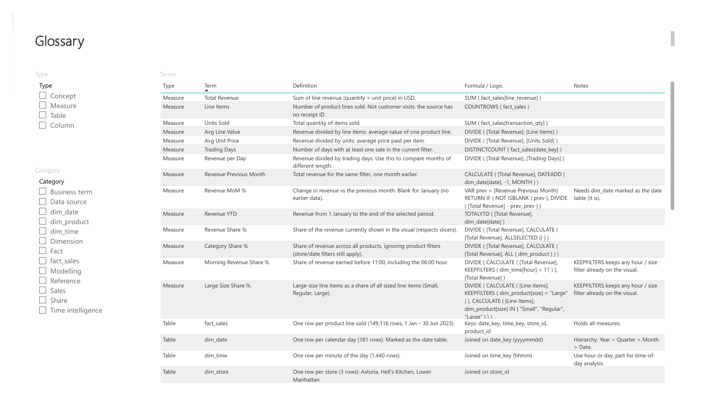

# Coffee Shop Sales: Star Schema & Power BI Report

End-to-end sales analysis for **Maven Roasters**, a fictional coffee chain with three stores in New York City (Jan–Jun 2023, 149,116 transaction lines).

The project takes a flat Excel export, rebuilds it as a **star schema** in Python, models it in **Power BI** with documented DAX measures, and turns the results into five evidence-backed insights and recommendations.



## Key findings

| # | Finding | Evidence |
|---|---------|----------|
| 1 | **Growth came from more sales, not higher prices.** | Revenue per day +111% (Jan $2,635 → Jun $5,550). Line items per day rose from 559 to 1,178. Average line value stayed flat at $4.65–4.72. |
| 2 | **Mornings carry the business.** | 7–11am is ~46% of revenue (49% including the 6am hour). Hourly revenue roughly halves after 11am. |
| 3 | **Stores differ by time of day, not by size.** | Each store has 33–34% of revenue. Lower Manhattan earns 57% before 11am and only 3% after 6pm. Astoria trades evenly until close. |
| 4 | **Coffee and tea are two-thirds of sales.** | Coffee 38.6%, Tea 28.1%. 43 of 80 products make 80% of revenue. The bottom 10 are all retail packs (loose tea, packaged chocolate, green beans) at ~2%. |
| 5 | **Day of week barely matters.** | Average revenue per day ranges only from $3,782 (Sun) to $3,911 (Mon), a 3% spread. |

**Recommendations:** staff up the 7–11am peak, test a 12–5pm drink + bakery bundle (+10% afternoon ≈ +$25k over six months), review Lower Manhattan's evening hours, and check retail-range margins before cutting products. Weekend campaigns and store-specific product plans are not supported by the data.

The full write-up with charts is in [`docs/analysis_report.html`](docs/analysis_report.html) (download and open in a browser), and all three report pages are in [`docs/CoffeeShopSales_report.pdf`](docs/CoffeeShopSales_report.pdf).

## Data model



| Table | Grain | Rows |
|---|---|---|
| `fact_sales` | one product line of a transaction | 149,116 |
| `dim_date` | one calendar day, marked as the date table | 181 |
| `dim_time` | one minute of the day | 1,440 |
| `dim_store` | one store | 3 |
| `dim_product` | one product | 80 |
| `Glossary` | one documented term (not related to other tables) | 45 |

All relationships are many-to-one and filter from dimension to fact only. The 14 DAX measures (revenue, per-day, MoM, YTD, shares) are in [`fact_sales.tmdl`](powerbi/CoffeeShopSales.SemanticModel/definition/tables/fact_sales.tmdl). Each has a description, and all are explained on the report's **Glossary** page.

## Report pages

| Overview | Insights | Glossary |
|---|---|---|
|  |  |  |

## Repository structure

```
├── data/
│   ├── raw/coffee_shop_sales.xlsx      # original export (Maven Analytics)
│   └── processed/                      # star schema CSVs + glossary.csv
├── etl/
│   ├── build_star_schema.py            # raw Excel → star schema CSVs, with integrity checks
│   └── requirements.txt
├── powerbi/                            # Power BI project (PBIP: PBIR report + TMDL model)
│   ├── CoffeeShopSales.pbip
│   ├── CoffeeShopSales.Report/
│   └── CoffeeShopSales.SemanticModel/
└── docs/
    ├── analysis_report.html            # written analysis with charts
    ├── CoffeeShopSales_report.pdf      # export of the 3 report pages
    └── screenshots/
```

## How to run

**1. Rebuild the star schema (optional, the CSVs are already committed)**

```bash
pip install -r etl/requirements.txt
python etl/build_star_schema.py
```

The script checks that transaction IDs are unique, every dimension key is unique, and every fact row matches a row in each dimension. It fails loudly if not.

**2. Open the report**

Requires a recent Power BI Desktop (Windows) that supports the PBIR report format.

1. Open `powerbi/CoffeeShopSales.pbip`.
2. Go to **Transform data → Manage parameters → DataFolder** and set it to your clone's `data\processed\` folder (keep the trailing `\`). It currently points to the author's machine.
3. Click **Refresh**.

The model's data cache is not committed, so the report is empty until you refresh.

## Data notes and limitations

- **No receipt or basket ID.** Each row is one product line, so "line items" are not customer visits, and basket size or attach rates cannot be measured.
- **No cost, staffing or margin data.** The findings are about revenue and timing, not profit.
- **The data is synthetic.** The three stores have near-identical revenue shares, growth and product mix, so store comparisons are illustrative.
- **Size labels:** four made-to-order drinks have no size in their name (Latte, Cappuccino, Espresso shot, Ouro Brasileiro shot). They are labelled `Unlabelled`. Bakery, beans, retail and merchandise are `Not applicable`.
- **Cleaning done in the ETL:** text fields are trimmed (e.g. `"Scottish Cream Scone "`). The source spelling `"Jamacian Coffee River"` is kept as-is.

## Data source

[Coffee Shop Sales](https://mavenanalytics.io/data-playground/coffee-shop-sales) from the Maven Analytics Data Playground, released into the public domain.

## Tools

Python (pandas) · Power BI Desktop (Power Query, DAX, PBIP/TMDL) · Git

## License

Code and report files: [MIT](LICENSE). Data: public domain (see above).
